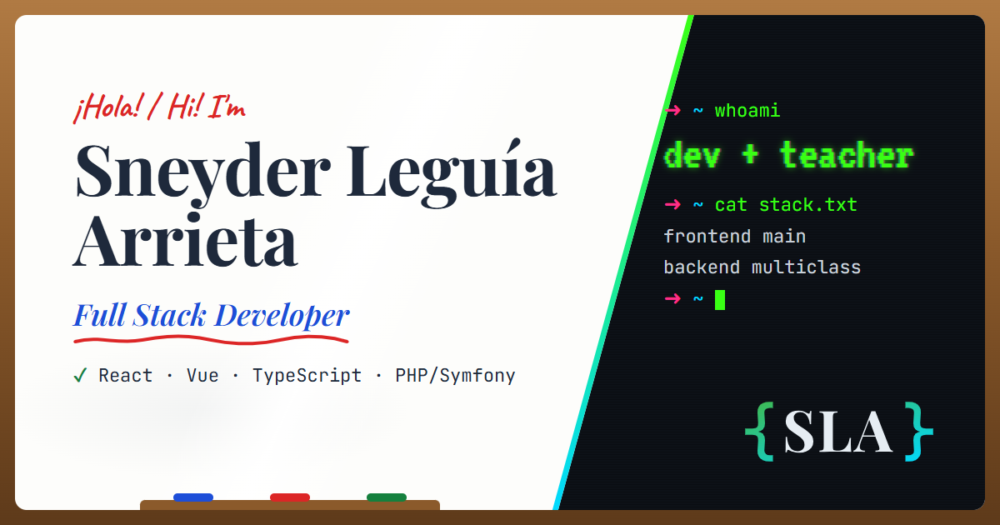

<p align="center">
  
</p>

<h1 align="center">Sneyder Leguía · Portfolio</h1>

<p align="center">
  Personal portfolio of a Full Stack Developer with 8 years of teaching experience.<br>
  Built with <strong>Astro</strong>, <strong>Tailwind CSS 4</strong> and <strong>GSAP</strong>.
</p>



## About

A single-page, statically generated portfolio with two themes that tell the same story from two sides:

| Theme         | Mode  | Look & feel                                                                |
| ------------- | ----- | -------------------------------------------------------------------------- |
| **Classroom** | Light | Whiteboard in an oak frame, markers, index cards and sticky notes          |
| **Geek**      | Dark  | Terminal window, CRT scanlines, vim status bar and retro-gaming references |

### Features

- **Light / dark themes**: follows the system preference and is applied before the first paint, so there is no flash.
- **Bilingual (ES / EN)**: Spanish at `/` and English at `/en/`, both prerendered. A toggle switch translates in place and keeps the URL in sync. All content lives in one typed file.
- **Animated storytelling** with GSAP:
  - The name is drawn like a marker stroke and the terminal types its commands.
  - Scroll-driven reveals, counters, a dev + teaching "fusion" diagram and flipping flashcards.
- **Projects** with a featured private project (Mesmeric ERP) and cards that show repo and demo links automatically once they exist.
- **Accessible**: single `h1`, skip link, keyboard-friendly navigation, 44px touch targets and AA contrast. Respects `prefers-reduced-motion`.
- **Performance**: static output, self-hosted fonts and inline SVG icons. No external CDNs.
- **SEO**: canonical URL, `hreflang` alternates, Open Graph and Twitter cards, sitemap, `robots.txt` and a themed 404 page.

## Tech stack

| Area      | Tools                                                                                       |
| --------- | ------------------------------------------------------------------------------------------- |
| Framework | [Astro 5](https://astro.build) (static site generation)                                     |
| Styling   | [Tailwind CSS 4](https://tailwindcss.com) via `@tailwindcss/vite`                           |
| Animation | [GSAP 3](https://gsap.com): ScrollTrigger, SplitText, DrawSVG, TextPlugin                   |
| Icons     | [astro-icon](https://www.astroicon.dev) + Iconify sets (`devicon`, `simple-icons`, `logos`) |
| Fonts     | `@fontsource`: Playfair Display, Poppins, Caveat, VT323, JetBrains Mono                     |
| SEO       | `@astrojs/sitemap`                                                                          |
| Language  | TypeScript (strict)                                                                         |

## Getting started

### Requirements

- **Node.js** `18.20.8`, `^20.3.0` or `>=22` (developed with Node 24)
- **pnpm** `>=9` (developed with pnpm 10). Install it with `npm install -g pnpm` or enable it with `corepack enable`.

### Run locally

```sh
git clone https://github.com/IrumaCode/sneyder-portfolio.git
cd sneyder-portfolio
pnpm install
pnpm dev
```

Open <http://localhost:4321>.

> If you move or rename files inside `src/icons/`, restart `pnpm dev`. The icon integration reads that folder only at startup.

### Scripts

| Command          | Description                              |
| ---------------- | ---------------------------------------- |
| `pnpm dev`       | Start the dev server at `localhost:4321` |
| `pnpm build`     | Build the static site into `./dist`      |
| `pnpm preview`   | Serve the production build locally       |
| `pnpm check`     | Type-check the project with astro check  |
| `pnpm format`    | Format the codebase with Prettier        |
| `pnpm verify`    | Type check, format check and build       |
| `pnpm astro ...` | Run Astro CLI commands                   |

Every push and pull request runs the same checks in GitHub Actions ([ci.yml](.github/workflows/ci.yml)).

### Environment variables

| Variable   | Default                 | Purpose                                                                                                                                 |
| ---------- | ----------------------- | --------------------------------------------------------------------------------------------------------------------------------------- |
| `SITE_URL` | `https://sneyderla.dev` | Public URL used for the canonical link, `hreflang`, Open Graph tags, sitemap and `robots.txt`. Override it only for other environments. |

## Project structure

```text
src/
├── assets/brand/      # SLA monogram (sla.svg)
├── components/
│   ├── sections/      # Hero, Experience, Projects, Skills, Contact
│   └── ui/            # Header, theme/language switchers, cards, logo
├── i18n/              # translations.ts: all ES/EN content
├── icons/             # Custom SVG icons for astro-icon
├── layouts/           # BaseLayout: meta tags, fonts, theme bootstrap
├── pages/             # index.astro
├── styles/            # global.css: design tokens per theme
└── utils/             # GSAP scroll animations and hero intros
public/                # Favicons and Open Graph image
```

## Editing content

All text lives in [`src/i18n/translations.ts`](src/i18n/translations.ts). Always update both `es` and `en`.

- **Projects**: fill in `repo` and/or `demo` for an item. The "Coming soon" badge disappears and the buttons show up.
- **Experience**: the years as a developer are computed at build time from `careerDates.devStart`.

## Deployment

Live at **<https://sneyderla.dev>**, hosted on **Cloudflare Pages** with automatic deploys from `main`.

| Setting                | Value                                                      |
| ---------------------- | ---------------------------------------------------------- |
| Framework preset       | Astro                                                      |
| Build command          | `pnpm build`                                               |
| Build output directory | `dist`                                                     |
| Node.js version        | 22 (from [`.node-version`](.node-version))                 |
| Environment variables  | None required (`SITE_URL` defaults to the official domain) |

- Every push to `main` deploys to production, and pull requests get preview URLs.
- [`public/_headers`](public/_headers) sets security headers and long-term caching for hashed assets.
- It also adds `noindex` on `*.pages.dev` preview URLs, so only `sneyderla.dev` is indexed.

The output in `./dist` is fully static, so it also works on any other static host.

---

© Sneyder Leguía Arrieta. All rights reserved.
